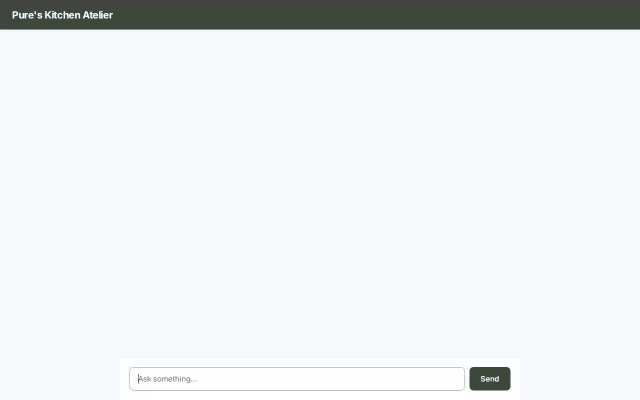

# Pure's Kitchen Atelier

A personalized AI culinary assistant built with Google Agent Development Kit (ADK), Agent Runtime, and Gemini 2.5 Flash.



---

## 🍳 Overview

**Pure's Kitchen Atelier** is an intelligent, multi-tool recipe and meal planning assistant. It helps users discover recipes from both a personal database and live external sources, calculates detailed nutritional breakdowns, generates dish imagery, and remembers individual dietary preferences across sessions using Vertex AI Memory Bank.

The assistant delivers clean, structured UI cards via **A2UI** (Agent-to-Agent User Interface) and connects to a custom web frontend built with FastAPI and modern sans-serif aesthetics.

---

## ✨ Implemented Features & Integrations

The agent is powered by Google ADK and integrates with the following services and tools:

- **🧠 Cross-Session Memory (Vertex AI Memory Bank)**
  Uses `VertexAiMemoryBankService` and `PreloadMemoryTool` to remember user preferences, allergies, and culinary facts across multiple turns and separate chat sessions.

- **🗄️ Database Recipe Management (Google Cloud Firestore)**
  - `get_recipes_by_ingredient`: Reads and filters recipe documents stored in a Google Cloud Firestore collection.
  - `add_recipe`: Writes new user-submitted or agent-created recipes directly into Firestore.

- **🌐 Live Recipe Search (TheMealDB API)**
  - `search_recipes_online`: Connects to free public endpoints on TheMealDB API to fetch real-world recipes, ingredients, and preparation steps with zero authentication required.

- **📊 Nutritional Breakdown Calculator**
  - `get_nutritional_info`: Estimates per-serving calories, protein, carbohydrates, and fats based on an ingredient list using a built-in macronutrient lookup table.

- **🎨 AI Image Generation & Storage (Imagen / Gemini + Cloud Storage)**
  - `generate_recipe_image`: Generates custom dish imagery using `gemini-3.1-flash-lite-image`, uploads the output to a Google Cloud Storage bucket, and returns public HTTPS URLs for display.

- **📱 A2UI Rich Card Rendering**
  Uses `A2uiSchemaManager` (v0.8) and `BasicCatalog` to emit structured A2UI parts (`Card`, `Column`, `Row`, `Text`, `Image`), allowing the UI to render rich cards natively alongside text.

- **💻 Web Chat Frontend & FastAPI Proxy**
  A lightweight FastAPI proxy (`frontend/main.py`) communicating over the A2A (Agent-to-Agent) protocol to bridge browser interactions with the deployed agent, styled as **Pure's Kitchen Atelier**.

---

## 🏗️ Project Architecture

```
recipe-assistant/
├── app/
│   ├── agent.py          # Root ADK Agent, tools, and Memory Bank callback configuration
│   ├── a2ui_utils.py     # A2UI callback handlers and schema management
│   └── db.py              # Firestore client initialization
├── frontend/
│   ├── main.py           # FastAPI proxy talking A2A to the agent
│   ├── requirements.txt  # Frontend dependencies (FastAPI, uvicorn, a2a-sdk, httpx)
│   └── static/
│       └── index.html    # Rebranded "Pure's Kitchen Atelier" chat UI & A2UI renderer
├── agents-cli-manifest.yaml # Agent Runtime deployment metadata
├── demo.gif              # Inline video demo of the chat UI in action
└── requirements.txt      # Python dependencies for the agent
```

---

## 🚀 Local Setup & Development

### 1. Prerequisites

- Python 3.11+
- Google Cloud SDK (`gcloud` CLI)
- Google Cloud Project with Firestore, Vertex AI, and Cloud Storage enabled

### 2. Environment Configuration

Clone the repository and install dependencies:

```bash
uv pip install -r requirements.txt
uv pip install -r frontend/requirements.txt
```

Authenticate with Google Cloud Application Default Credentials (ADC):

```bash
gcloud auth application-default login
gcloud config set project YOUR_PROJECT_ID
```

### 3. Running the Agent Locally

Run the local development server with memory bank support:

```bash
uv run adk web . --port 8080 --reload_agents --memory_service_uri=agentengine://YOUR_MEMORY_BANK_ID
```

### 4. Running the Frontend Proxy Locally

In a separate terminal, navigate to the `frontend/` directory and launch the proxy server:

```bash
cd frontend
export AGENT_ENGINE_RESOURCE_NAME="projects/YOUR_PROJECT_NUMBER/locations/us-east1/reasoningEngines/YOUR_AGENT_ENGINE_ID"
export AGENT_DIRECTORY="app"
export PORT=8080

uv run python main.py
```

Open your browser to the local server port configured above to interact with **Pure's Kitchen Atelier**.

---

## 📄 License

Apache License 2.0. See project files for details.
